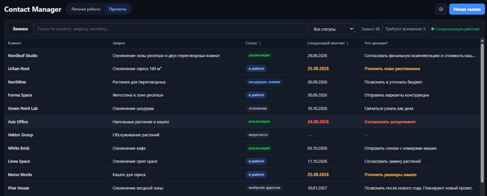
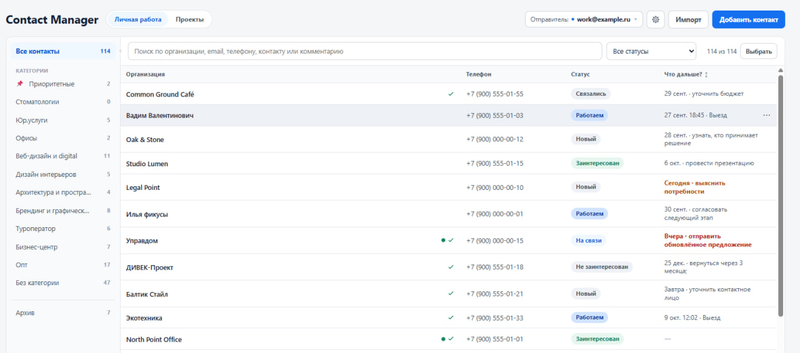
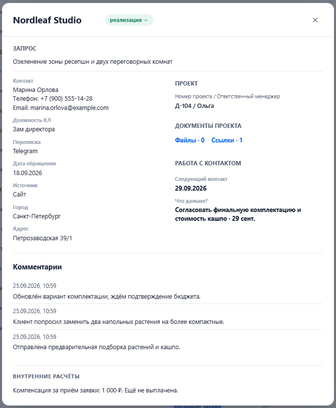
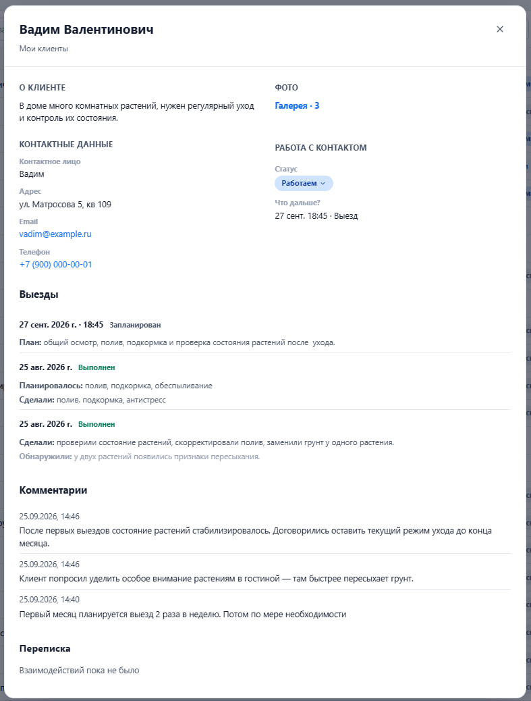
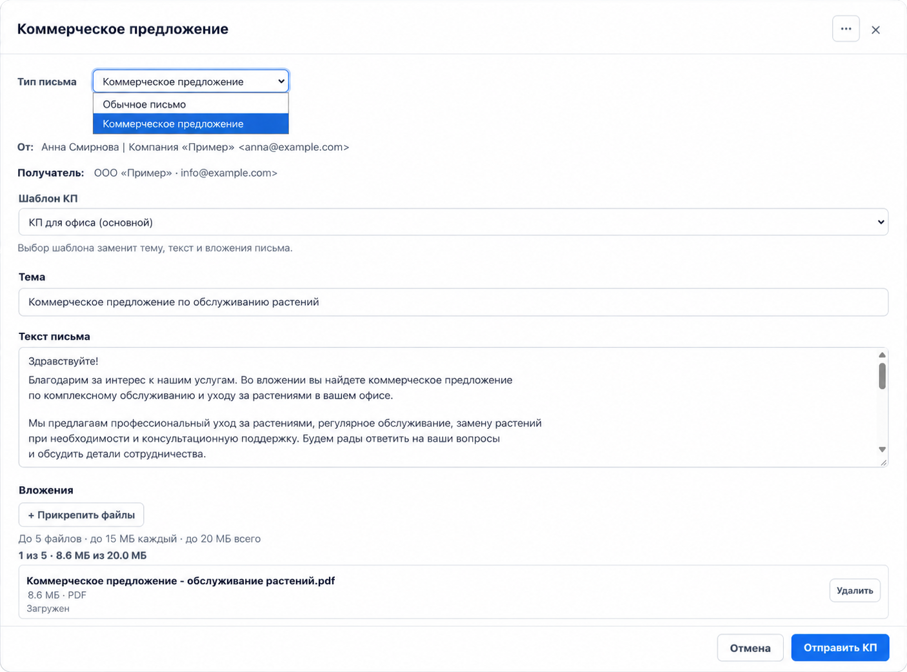

# Андрей — AI Automation Engineer

Занимаюсь разработкой IT-проектов, автоматизацией бизнес-процессов и интеграциями с использованием AI-инструментов и AI-агентов.

Мой основной формат работы - превращать задачу в формате «нужно, чтобы работало вот так» в работающий технический результат: от проектирования решения и выбора инструментов до реализации, тестирования и отладки.

### Основные направления

- AI-assisted разработка и работа с AI-агентами
- автоматизация бизнес-процессов
- API-интеграции
- внутренние веб-сервисы и инструменты
- Telegram-боты и AI-ассистенты
- работа с ChatGPT, Claude, Codex и локальными AI-моделями
- тестирование, поиск причин ошибок и доведение решений до рабочего состояния

> Большая часть рабочих репозиториев приватная. Ниже представлены описания отдельных проектов и реализованных решений.

## Selected Projects

### Contact Manager
Внутренняя CRM-система для небольшой компании.

- управление клиентами, проектами и действиями сотрудников;
- поиск, фильтрация, категории, история взаимодействий и контроль следующих контактов;
- импорт данных из XLSX/CSV;
- интеграция с почтой и Google Таблицами;
- внутренняя автоматизация и синхронизация данных;
- тестирование и развитие системы по обратной связи реальных пользователей.

Система используется в рабочем процессе компании.

#### Интерфейс

*На скриншотах показаны демонстрационные данные.*

Нажмите на превью, чтобы открыть скриншот в полном размере.

  
  
  
  
  

---

### KPP Platform
Прототип системы автоматического распознавания бумажных списков посетителей.

- OCR и мультимодальные AI-модели;
- распознавание ФИО и дат рождения;
- сравнение нескольких независимых моделей;
- автоматическое принятие совпадающих результатов;
- передача спорных случаев человеку вместо скрытых ошибок;
- локальный сценарий работы без обязательного постоянного доступа к интернету.

В экспериментах одна из локальных мультимодальных моделей показала около **99% точности по отдельным полям**.

---

### Green Radar
Система сбора и первичной обработки коммерческих тендеров и закупок.

- автоматический сбор данных из множества источников;
- нормализация и хранение информации;
- фильтрация заявок по профилю бизнеса;
- классификация на релевантные, возможные и нерелевантные;
- веб-интерфейс для просмотра, принятия решений и дальнейшей работы с найденными заявками.

Проект создавался как инструмент, который заменяет ручной просмотр большого количества закупочных площадок.

---

### AI-powered Web Service
Разрабатываемый веб-сервис с собственной моделью данных и AI-компонентами.

- backend на Django и PostgreSQL;
- обработка пользовательских запросов естественным языком;
- определение релевантных сущностей и параметров поиска;
- подбор информации из собственной структурированной базы;
- проектирование пользовательских сценариев, модели данных и логики рекомендаций;
- использование AI-агентов в процессе разработки и тестирования.

Название и часть деталей проекта пока не публикуются.

---

### Telegram AI PoC
Прототип Telegram-бота с интеграцией AI-модели через API.

- обработка пользовательских сообщений;
- передача запросов AI-ассистенту;
- сохранение контекста диалога;
- возврат сформированного ответа в Telegram;
- проверка сценария использования AI как части пользовательского продукта.

## Tools & Technologies

ChatGPT · Claude · Codex · API integrations · Telegram · Django · PostgreSQL · SQLite · Google Sheets · OCR · Local AI models · Git · Docker

## Contacts

- Telegram: https://t.me/tipazloy_projects
- GitHub: https://github.com/TipaZloy

<!--
**TipaZloy/TipaZloy** is a ✨ _special_ ✨ repository because its `README.md` (this file) appears on your GitHub profile.

Here are some ideas to get you started:

- 🔭 I’m currently working on ...
- 🌱 I’m currently learning ...
- 👯 I’m looking to collaborate on ...
- 🤔 I’m looking for help with ...
- 💬 Ask me about ...
- 📫 How to reach me: ...
- 😄 Pronouns: ...
- ⚡ Fun fact: ...
-->
